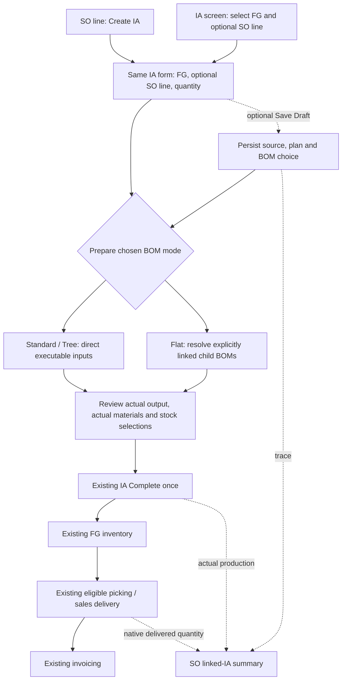

# Small Cycle IA implementation Contract

Date: 19 October 2026. Scope: standard Item Assembly only; MC2 and the existing MES are excluded. Related enhancements: ENH-20261015-010 and ENH-20261015-011.

Build a small production cycle for the existing IA client: optionally link one SO line to an IA, choose Standard/Tree or Flat BOM consumption, review actual materials, complete through the current IA stock flow, and use existing sales delivery and invoicing. Retain standalone IA and allow several IAs for one SO line.

This is the consolidated current business scope. It supersedes earlier broader JO/MES, multi-SO allocation and automatic replacement proposals for this release. The [chronological study](2026-10-19-item-assembly-small-cycle-so-flat-bom.md) remains supporting history, not an instruction to implement its superseded proposals. Simulator v129 illustrates the accepted flow. Section 14 adds the Developer Implementation Contract with captured exact fields/caller payloads, proposed additions and DC01–DC12 confirmation gates. Section 15 records the full-document compatibility review and corrections. Developer owns final physical mapping, implementation and all runtime, regression and UAT execution; no product changes or runtime tests are claimed here.

## 1. Implementation constraint and items to resolve first

Use SUDU LOWCODE, including Code and SQL nodes, without backend changes. Reuse the existing IA completion/reversal and inventory/accounting owners. No requirement in this slice is established as impossible in LOWCODE from the inspected evidence, but deployed transaction guarantees have not been verified.

Before implementation, the developer must identify and report any unsupported capability, especially:

- Durable stock completion/reversal across IA, component issues, FG receipt, costing and batch/HU; safe retry and concurrent stock use. Existing accounting submission is a separate continuation with its own posting status; a queue failure must not trigger stock reposting or become a new mandatory atomic stock-plus-external-accounting transaction.
- A reliable existing source identity between SO header, exact SO line, IA and relevant delivery/receipt data, including enough provenance to avoid counting production and its delivery twice.
- Server-side action permissions, tenant/organization scope, native source/status eligibility and existing UOM/precision rules.
- Storage and execution of a validated saved Flat consumption list through the existing IA stock-movement contract.

Do not silently weaken a control, assume a multi-node workflow is one transaction, invent receipt provenance, introduce a parallel stock ledger or add backend changes to close a gap. A UI-only warning does not solve posting or permission guarantees. An uncertain completion must not be blindly reposted; map safe recovery to existing capabilities and flag any missing capability before delivery. No new routine approval procedure or production status is added by this handoff.

## 2. Scope and deliberate exclusions

| Included in this release | Outside this release |
|---|---|
| One optional exact SO line per IA; many IAs per line | Multiple SO lines/customers allocated inside one IA |
| IA entry and SO-line shortcut using one IA form | JO layer or replacement of the standard IA lifecycle |
| Editable remaining-unplanned suggestion and excess warning | MRP, ATP, guaranteed customer stock allocation or a supply scheduler |
| Per-IA Standard/Tree or recursive Flat consumption | Automatic SFG-stock-first blending, child IA generation or multistage WIP |
| Actual-output and actual-material review; complete once | Partial reporting, automatic replacement, raw-wastage/reject/rework modules |
| SO linked-IA summary; delivered quantities separate | New production dashboard, quality or warehouse-task engine |
| Existing stock, costing, delivery, invoice and reversal behavior | New valuation, labour/machine costing or accounting rules |
| Manual response to source SO reductions/cancellation | Automatic resizing, cancellation, stock reversal or SO closure |

WO visibility, duplicate-WO warnings and new WO integration are omitted because the user plans to retire WO separately. The IA suggestion is not a complete mixed WO/IA supply calculation. This handoff does not authorize deleting/disabling WO, migrating its documents or changing current SO→WO/reservation behavior. Existing native permissions, tracking, quality/category and warehouse requirements remain applicable even where new modules are excluded.

## 3. Evidence baseline and current gaps

| Area | Evidence inspected | What is established | What remains to verify |
|---|---|---|---|
| IA model and form | 13 October configuration export: `sm_item_assembly` model `2098256587713404929`, page `2098312073316716546` | Existing FG/quantity/UOM/plant/output-location fields, component stock selections and standard IA form callbacks | Current client configuration, native status literals, writable actual-quantity/material fields and complete payload mapping |
| IA completion | 16 October read-only DEV definition: IA_SAVE `2098335576774463489`, version 11 | Existing component issue, FG receipt, costing/batch/HU orchestration and sequential re-completion checks | Deployed atomicity, simultaneous calls, partial failure/retry recovery, permissions and legacy regression |
| IA reversal | 16 October read-only DEV definition: IA_REVERT `2099319746652852225`, version 4 | Full reversal with stock/movement/costing/batch/HU checks and return-to-Draft path | Current runtime behavior and compatibility with saved mode/source/materials |
| BOM master | 13 October `bill_of_materials` model `1902195284188975106` | Header output/base quantity/UOM/version/active fields; component child-BOM reference and independent consumption flag | Current master-data quality, child selection behavior and all required conversion/validation rules |
| IA BOM preparation | Captured `onChange_assembledItem`, callback key `wv07g9xe` | Reads direct consumable rows, excludes `consume_type=REF`, scales quantities and builds component movement inputs | Recursive Flat execution is absent from this inspected callback; runtime integration is not proven |
| SO and delivery | Captured sales model `1902773735979597826` and prior IA/SO/reservation audits | Existing sales/delivery and IA owners are separate | Exact native SO-line key/statuses, persisted link fields, delivered-quantity definition, provenance and authorized summary query |
| Simulator | Local v129, fixed in-memory EA examples | Demonstrates the agreed choices and visible quantity separation | Not evidence of durable LOWCODE posting, live stock, client permissions or production compatibility |

These are dated exports and read-only workflow definitions, not current-client deployed verification. No business-stock transaction, workflow import, tenant design change or runtime probe is requested for this consolidation.

Evidence references: [BOM and IA source audit](item-assembly-small-cycle-evidence-2026-10-19/bom-ia-source-audit.json), [IA workflow evidence and mapping](2026-10-16-item-assembly-lowcode-mapping-validation.md), [sanitized workflow fingerprints](item-assembly-lowcode-validation-2026-10-16/evidence-index.json). Larger-flow mappings in those references are not added to this release.

## 4. SAP reference baseline and SUDU adaptation

SAP is the process reference. It does not prescribe this exact per-IA mode switch or embedded SO summary.

| SAP baseline | SUDU baseline | Gap | Requirement for this small cycle |
|---|---|---|---|
| Manufacturing may reference an exact sales order item/material/quantity. Configured MTO can use dedicated sales-order stock [S1] | Proposed optional IA source link; native IA and sales stock owners are separate | Need source trace without special-stock complexity | Persist exact optional source; one line per IA, multiple IAs per line; ordinary stock remains unchanged |
| Configured phantom components are incorporated into a superior assembly; a real intermediate has different physical production/stock meaning [S2] | BOM can reference another BOM, but inspected IA loader only reads direct rows | Nested master data alone does not give recursive consumption | Reuse BOM master; explicit Tree/Flat consumption list; never deduct a replaced intermediate and its children on the same path |
| PP confirmations can record actual yield at order or operation level; cancellation and status rules are separate [S3] | Standard IA has one completion/posting owner | Need short completion without MES reporting stages | Review actual output/materials and complete once; manually create a later IA if needed |
| Production receipt increases warehouse stock; outbound sales fulfilment is a separate process [S4, S5] | IA receipt and native GD/SI remain separate | Source trace must not become delivered quantity or customer stock protection | Complete into ordinary eligible stock; existing delivery/invoice owns sales quantities; no new FG reservation |
| Configured PP/ECM changes to running orders are controlled and traceable [S6] | Source-driven automatic IA changes not verified | SO edits must not silently rewrite production actuals | Warn planner; manual permitted Draft response; completed output/history/stock unchanged |
| PP-MRP monitoring provides status/requirements context and navigation under scoped responsibility [S7] | No deployed linked-IA SO summary verified | Sales/planner needs simple visibility | Read-only exact-line IA summary and authorized drill-down; keep production and delivery separate |

Deliberate SME deviations: no SAP release/operation-confirmation sequence, special-stock valuation, MRP, OCM approval machinery or new EWM-style tasks. Use the existing SUDU Draft→Complete flow and native inventory/accounting rules. SAP production-order “delivered” can describe receipt to the warehouse; it must not be mapped to SUDU SO delivered-to-customer quantity.

Source register, official sources refreshed 19 October 2026:

- **S1** — [Discovering Sales-Order-Related Production](https://learning.sap.com/courses/explaining-scenarios-in-production-accounting/discovering-sales-order-related-production-make-to-order-scenario_d906dcbd-8f0f-48e3-882f-aab1fa43651c). General S/4HANA PP/production accounting; edition/release unspecified. Strategy, requirements class, individual/collective requirements and valuation settings govern its stock scenario. SUDU does not adopt that dedicated-stock scenario.
- **S2** — [Describing Phantom Assemblies](https://learning.sap.com/courses/exploring-basic-data-for-manufacturing-and-product-management-in-sap-s-4hana/describing-phantom-assemblies). General S/4HANA PP/manufacturing master data; edition/release unspecified. Material special-procurement and BOM-item settings determine explosion behavior. A SUDU reference link is not automatically a SAP phantom designation.
- **S3** — [Posting Confirmations for Production Orders](https://learning.sap.com/courses/manage-production-orders-in-sap-s-4hana-manufacturing/posting-confirmations-for-production-orders). General S/4HANA PP; edition/release unspecified. Order/operation release and selected confirmation approach matter. SUDU retains a single IA completion, not SAP confirmation statuses.
- **S4** — [Posting Goods Receipts for Production Orders](https://learning.sap.com/courses/manage-production-orders-in-sap-s-4hana-manufacturing/posting-goods-receipts-for-production-orders). General S/4HANA PP/MM inventory management; edition/release unspecified. Manual/automatic receipt and confirmation integration are configuration-dependent; no identical SUDU transaction boundary is inferred.
- **S5** — [Producing and Selling Standard Products in the Warehouse](https://learning.sap.com/courses/implementing-sap-s-4hana-cloud-public-edition-warehouse-management/producing-and-selling-standard-products-in-the-warehouse_a70b1f00-5dfd-4256-917a-68666714e353). S/4HANA Cloud Public Edition Warehouse Management, scope 54V; course release unspecified. Used for production-versus-sales separation; its warehouse/MRP/QM scenario is not imported wholesale or conflated with on-premise EWM.
- **S6** — [Managing changes for Production Orders](https://learning.sap.com/courses/implementing-engineering-change-management-in-sap-s-4hana/managing-changes-for-production-orders_b5f2b07b-b2a9-4f7a-849a-efce6226512f). General S/4HANA PP/ECM OCM; edition/release unspecified. Overall change profiles, material assignments, OCM release keys and applicable SD requirements-class settings control behavior; some configured assembly scenarios propagate changes after checks. SUDU's warning/manual policy is a deliberate simplification.
- **S7** — [Monitor Production Orders or Process Orders](https://help.sap.com/docs/SAP_S4HANA_ON-PREMISE/fe39e10a9a864a8f8dc9537704f0fa13/50d61556d22c0033e10000000a44538d.html?locale=de-DEversion%3D1809.001). Official on-premise Help indexed as 2025 FPS01, February 2026, PP-MRP/PP-FIO-MRP. Responsibility, shortage definitions, Fiori setup and permissions apply. Canonical direct reader returned a shell; indexed content is the bounded reference, not a verified SAP SO-embedded screen.

Unresolved SAP detail: exact editions/releases of the general Learning courses are unspecified, and direct Help rendering is incomplete. No universal SAP flat-consumption, shared-form or manual-cancellation rule is asserted. The SUDU requirements above are the agreed adaptation, not claims of SAP equivalence.

## 5. End-to-end business flow and roles



| Stage | Responsible user | Required behavior | Inventory/accounting effect |
|---|---|---|---|
| Open/create | Existing authorized sales/planner/IA user | Either entry route reaches the same form; source remains optional | None from opening the form or linking SO |
| Save Draft | Existing authorized IA user | Save source, plan, mode, selected BOM/version and prepared rows as applicable | No new issue/receipt/reservation from this enhancement; preserve native behavior |
| Prepare/review | Authorized assembly user | Review the chosen consumption list, actual output/usage and valid stock selections | No issue/receipt until existing completion |
| Complete | Existing IA completer | Revalidate and invoke current posting owner once at actual quantities | Issue selected actual components; receive actual FG; current costing/valuation/accounting |
| Deliver/invoice | Existing warehouse/sales/accounting users | Follow native stock eligibility, picking, delivery and invoicing | Existing delivery/invoice effects only; no repeat material issue |
| Source changes/shortfall | Planner | Warn, review and manually adjust permitted Draft or create another IA | No automatic stock, SO or completed-IA changes |
| Reversal | Existing authorized reversal role | Use native full-reversal restrictions and saved inputs | Existing eligible reversal once, including costing/tracking effects |

Saving Draft first is optional where the native IA form currently permits direct Complete or Complete & Post from Add. The same server action must persist the new source/plan/snapshot and actual transaction consistently; no extra preliminary save, release or approval is introduced. Native auto-allocation and existing material-variance confirmation may continue, subject to current permissions and reviewed actuals.

Draft and Complete are business labels. Map them to the actual deployed `item_assembly_status`/`posted_status` contract; do not rename native status values or add Released, Started, WIP, QC or Putaway statuses. Simulator steps are view navigation, not new production procedures.

## 6. IA changes

### IA01 Shared entry form and source link

- Existing IA entry: user selects FG, then optionally selects one matching eligible SO line. Standalone IA remains valid.
- SO-line shortcut: prefill FG, exact source header/line and suggested quantity; open the same IA form. No second save/complete implementation and no stock effect from shortcut navigation.
- Validate source identity, FG, UOM conversion, native sales eligibility and organization/tenant/role scope server-side. Repeated FG lines in one SO must remain distinguishable.
- Allow only one source line per IA. Several independent IAs may reference it. No source allocation subform, per-customer output allocation or mandatory JO.
- Source/FG edits on permitted Drafts must be deliberate, logged and revalidated. Changing FG must clear or reject an incompatible source and invalidate affected materials/selections. Completed source and stock fields stay protected by existing restrictions.
- Opening an unsaved IA form does not add planning coverage. Persisted eligible Drafts contribute only after successful save.

### IA02 Remaining quantity suggestion and warning

Use one common scoped calculation for the IA form, SO shortcut and SO summary:

```text
Suggestion = max(0, active source demand
                   - native delivered quantity
                   - other eligible open Draft IA quantities
                   - other eligible completed IA output not already counted in delivery)
```

Context is explicit: a new unsaved IA and the SO summary include all eligible persisted linked IAs (`excludeIaId=null`); refreshing an existing Draft excludes only that Draft's stable ID. The excess-warning calculation replaces that current Draft's saved coverage with its proposed quantity exactly once, rather than adding old and edited values together. A completed IA's view never excludes its output from the SO summary. Values must use compatible UOMs. Closed unproduced plan balances are not supply; saved original plans remain comparison/history. Cancelled source has no new active demand, while historical sales quantities remain visible under native definitions.

Example: SO100 with another saved Draft60 suggests40. User may edit to50; show demand100, coverage110 and excess10, but excess alone must not block preparation/completion, require approval or require a reason. Current positive-quantity, stock, tracking and permission rules still apply. If suggestion is0, show0; do not silently change it to1. Follow native Draft-save validity rather than introducing zero-quantity persistence solely for the demo.

Recompute eligibility and coverage on relevant save/complete actions and refresh; do not resize another IA or overwrite a user's entered quantity merely because the screen was reopened. A deliberate source selection or Use suggested quantity action may fill the current Draft.

**Delivery deduplication is a developer mapping gate:** do not subtract both a delivered receipt and that same receipt's full production again. Native delivery may come from unrelated stock, and source-linked IA stock can be used by another SO. Use evidenced identities/fulfilment semantics; do not assume FIFO, exclusive stock, or `delivered = linked IA produced`. The suggestion is production-planning guidance, not an inventory promise, physical shortage calculation or complete WO/IA/stock supply planner. If the deployed data cannot support the required projection, highlight the limitation before implementing a misleading formula.

### IA03 BOM mode, saved inputs and master changes

- Add a consumption choice: **Standard / Tree** or **Flat**. Existing/default and historical mode-less IAs keep their current direct-input behavior. Flat is explicitly selected; no global reinterpretation of old BOMs.
- Select mode before material/bin/batch/HU selection. For the enhanced saved-snapshot path, an explicit mode/BOM refresh rebuilds affected prepared reference rows and clears/revalidates affected stock selections, with no stock posting. An intended-plan rescale must offer the current Re-scale/Keep behavior where supported and must not silently erase manual components/usage. Actual-output review follows IA04 instead of that destructive rescale path.
- Save root/child BOM identities and versions, chosen mode, a reproducible calculation basis and resolved component quantities/UOM/path evidence with the IA. The basis must preserve the used source row quantities/base UOMs, allowance/conversion and rounding inputs, or an equivalent immutable executable representation; IDs/version labels and previously rounded totals alone are insufficient. Completion uses reviewed saved actual picks; reversal uses posted actuals and native movements/cost records, not a re-explosion of either latest master or reference snapshot.
- A Draft may explicitly refresh/reprepare from an eligible BOM/version before completion; show the resulting material difference and require affected selection review. Master edits do not silently rewrite saved/completed IAs. Completed mode/material/source changes remain subject to current locking/reversal rules.
- Opening/viewing a saved IA must rehydrate its saved rows/picks without firing preparation that overwrites them. A missing legacy snapshot or mode default alone must not opt an old record into new calculation/validation. Legacy Drafts can explicitly prepare the enhanced snapshot; legacy records otherwise retain their current path. Flat always requires its valid saved snapshot.
- There is no process-route, machine, JO or child-IA requirement in this slice.

### IA04 Actual output and actual material review

Keep a saved plan/history for comparison and the actual FG quantity that will be received. The existing `item_qty` may remain the current posting quantity if that fits the deployed contract; the logical plan/actual distinction does not require a new planning subsystem.

Autofill the BOM reference for the intended actual output. Allow review/edit of actual component usage under existing rights. Display reference and actual usage distinctly. On the enhanced path, changing actual output recalculates references from the saved calculation basis, preserves entered actual components/usage and requires affected stock selections to be revalidated for review. It must not invoke the captured `onChange_itemQty`→`onChange_assembledItem` master rebuild implicitly. Existing legacy Re-scale/Keep behavior remains for its current callers. Do not add a separate wastage/rejection transaction in this release.

Preserve current permitted manual component additions/removals/quantity differences and their existing variance-review behavior. A BOM snapshot is a reference baseline, not a new hard component whitelist or a requirement to issue every reference row. Actual rows still require valid authorized item/stock/UOM/tracking identities. Missing or failed Flat resolution cannot be disguised as a manual variance to post an incomplete preparation.

Example: plan10, actual6, reference Frame6/Screw24, reviewed actual Frame7/Screw25. Completion receives6 and issues7/25 once. It does not issue10/40 or silently replace the reviewed consumption with6/24. Native batch/serial/HU/category/bin/UOM checks remain mandatory. Quantity and stock rules come from the product, not the simulator's integer-only 1–100 demo limit.

### IA05 Complete once and close a short batch

- Revalidate saved source/mode/materials, actual output, actual picks and permissions, then use the current IA completion owner once.
- Save actual FG received and material quantities posted, retaining source and plan/change history. The actual quantities drive existing inventory cost and current receipt unit-cost calculation; do not add new optional cost categories or a second accounting owner.
- Short actual output completes this IA at actual quantity. Keep source demand/delivery open as defined by native sales rules. Do not retain the unproduced plan as pending supply, auto-create replacement work or reopen the completed IA.
- Planner manually creates another IA for the source line. Its suggestion considers current eligible supply; its saved BOM/material review and completion are independent. Do not repeat the earlier IA's material issue.
- If stock is insufficient, retain native validation. No partial-issue/start procedure or material-shortage override is added by this scope.

### IA06 Source reduction, cancellation and history

When source demand is reduced or cancelled, warn with source identity, prior/current quantity/status and affected IA plan/actuals. Check source state when opening/refreshing and on relevant save/complete. No push notification engine or acknowledgement status is required.

Do not automatically resize, cancel, reopen or replace IA; rebuild materials; change source; close/deliver SO; or reverse completed stock/costs. Planner manually changes a permitted Draft or explicitly uses the standalone stock path where native rules permit. Completed actuals/output remain unchanged. Distinguish creating/selecting a new source from handling an already linked Draft: the latter receives the accepted warning/manual response and is not newly blocked solely because a trace-only SO link became reduced/cancelled. Respect any proven native action restriction; do not invent a source-cancellation completion veto or auto-unlink. A planner may explicitly detach an eligible Draft for stock. Exact header/line rejection, closure and cancellation eligibility must be mapped from native sales fields, not guessed from the demo's Cancelled label.

Use existing history mechanisms where possible to retain actor/time, source change, plan/actual changes, selected mode/BOM versions, reviewed material changes and relevant posting/reversal references. A read-only summary visit does not create a production change event.

## 7. BOM changes

### BOM01 Reuse the existing master

Do not create a second BOM master or permanently flatten a master just for IA. Keep existing versions, default/active selection, base quantity/UOM and component quantities. A real intermediate can have its own BOM, with an explicit reference from the parent where Flat expansion is intended.

Captured fields to reuse, subject to deployed mapping:

| Level | Existing property | Meaning for this change |
|---|---|---|
| Header | `parent_material_code` | Output item identity; verify whether stored values are IDs rather than displayed codes |
| Header | `parent_mat_base_quantity`, `parent_mat_base_uom` | Output quantity/UOM that the BOM produces; basis for scaling |
| Header | `parent_mat_bom_version`, `is_active`, `parent_mat_is_default` | Existing version/selection rules; do not change other readers' defaults |
| Component | `bom_material_code`, `sub_material_qty`, `sub_material_qty_uom` | Component identity and quantity/UOM |
| Component | `sub_material_wastage` | Existing BOM allowance percentage; not a new actual-wastage record |
| Component | `bom_type`, `ref_bom_id` | Explicit referenced child BOM where configured |
| Component | `consume_type` | Independent executable/nonconsuming flag |

`bom_type=reference` links a child BOM. **It is different from `consume_type=REF`, which is informational/nonconsuming in the captured IA loader.** A referenced child can still be consumable USE. Do not equate the two labels or consume an informational subtree because it has a child reference.

Flat-readiness checks belong to the explicitly selected IA Flat preparation. Do not make all existing BOM saves, direct-mode IA, procurement/planning or old MES readers depend on a valid recursive tree, new fields or snapshots. Preserve shared BOM records, defaults, visibility, field meaning and source selectors; a shared master validation change beyond this scoped consumer needs its own impact assessment.

No new mandatory BOM header fields are established as necessary by the captured schema. Required master/form work is to ensure child references are usable and valid for IA preparation: correct item/version/scope, visible selection/identity and validation where current controls are insufficient. Reuse the existing selector when it satisfies the requirement; no separate tree editor is required.

### BOM02 Consumption behavior

For the same saved source structure:

```text
Box BOM, output 1 Box
  Frame 1  -- explicit link to Frame BOM
  Screw 4

Frame BOM, output 1 Frame
  Panel 2
```

| IA mode | Inputs for 1 Box | Receipt | Frame stock effect |
|---|---|---|---|
| Standard / Tree | Frame1 + Screw4 | Box1 | Issue1 |
| Flat | Panel2 + Screw4 | Box1 | None from this IA |

Tree preserves existing direct executable input handling. Displaying a nested hierarchy does not authorize issuing every displayed level. In Flat, recursively substitute only valid explicit child references; terminal or deliberately non-expanded stock components remain inputs. Do not search for any arbitrary BOM attached to an item and explode it automatically. Do not both consume the referenced Frame and its Panels on the same expanded path. Flat receives only the IA FG, with no intermediate receipt, automatic child IA or SFG-stock-first mixture.

### BOM03 Recursive preparation and essential guards

The Flat resolver must:

1. Resolve the chosen root and explicit child BOM records/versions within authorized scope and validate child output matches the referenced component.
2. Scale at every BOM base, converting the parent required component quantity to the child output UOM before applying its ratios. With no wastage, `required component = required BOM output / BOM base output × component qty`, after necessary compatible UOM conversion.
3. Preserve native allowance/precision/serial rules. The captured direct callback uses `(output / BOM base) × component qty × (1 + wastage% / 100)` and rounds serialized component requests up. Establish and validate nested allowance and rounding order against the existing contract; do not invent a new yield/scrap model or copy the simple EA demo as production arithmetic.
4. Exclude nonconsuming REF rows; recursively replace executable references; emit valid terminal inputs.
5. Aggregate only compatible material/UOM/stock-relevant requirements, preserving source paths and selected BOM versions for explanation. Do not merge different stock constraints or round away required tracked units.
6. Validate missing/invalid references, cycles, impossible UOM conversion, nonpositive BOM bases and unresolved item/version identities. Stop preparation with an actionable message rather than silently omitting a component. Use a bounded traversal and developer-selected operational limits.
7. Produce the same existing stock-input contract used by IA material selection and completion, with the required identity/scope/tracking fields. Save the resolved list with IA.

Example for base scaling, before allowance/UOM adjustments: a root BOM produces10 Boxes using20 Frames and40 Screws; a child BOM produces2 Frames using6 Panels. For5 Boxes, Tree requires10 Frames/20 Screws; Flat requires30 Panels/20 Screws. This exposes errors that a unit-base example would hide.

These validation and stock-integrity guards are required for Flat; they are not minor edge cases to defer. Fancy tree visualization, configurable explosion preferences and complex substitutions are backlog.

## 8. Sales Order changes

### SO01 Shortcut to the common IA form

Add a line-level Create IA action for eligible native SO lines and existing authorized users. Pass exact source identity, FG and suggestion to the same IA form. Do not replace existing SO→WO, run its reservation logic from this shortcut, post stock, or increment native WO/planned/delivered counters merely to trace IA.

### SO02 Linked IA summary

On the exact SO line show:

| Sales fulfilment group | Production group |
|---|---|
| Native ordered quantity | Linked IA number and current native status |
| Native delivered quantity | Saved planned quantity and actual produced, separately |
| Native undelivered/outstanding quantity | Open eligible Draft quantity and remaining-unplanned suggestion |

Show linked IAs only for that exact source, not all rows for the customer/FG. Keep standalone IAs and other source lines out. An IA number opens the same existing form subject to rights/status. Creation uses the approved shortcut. Read failures/unauthorized data must not be presented as a trustworthy zero, and aggregates must not expose unauthorized production data.

Use the same accepted quantity projection as the IA form. Do not sum saved completed plans as actual supply, overwrite native sales counters, mark SO complete from production, or imply that associated output is reserved/available for that customer. Native delivery is the owner of delivered quantity, including its existing status, cancellation and reversal semantics.

Refresh on open/refresh and relevant successful IA save/complete/revert and native delivery changes. Use available LOWCODE events or a fresh read on reopening; real-time push is not required. Summary navigation itself changes no stock, sales documents, actuals or statuses.

## 9. Logical data and existing workflow mapping

Names below describe required information, not allocated new physical columns or a mandated migration. Reuse suitable fields; developer must map types, ownership, constraints, indexes and source-line storage before implementation.

| Information | IA behavior | Compatibility requirement |
|---|---|---|
| Optional SO header ID + exact line ID | Stable identity; display SO/line/customer as context | Nullable for standalone/legacy; no matching by displayed code alone |
| Source quantity/status context | Supports warning and audit comparison | Native SO remains owner; no cloned demand balance |
| Saved plan and actual output | Keep comparison/history; post only actual | Do not overload native delivered or WO counters; preserve existing receipt quantity contract |
| Consumption mode | Explicit Tree/Flat on Draft | Missing legacy mode uses old behavior; no historical re-explosion |
| Root/child BOM IDs and versions | Save selected source identities and resolved-list evidence | Current master updates cannot rewrite completed consumption |
| BOM reference and reviewed actual component quantities | Review and select against the prepared list | Distinguish expected from posted usage; preserve existing precision/tracking |
| Existing material picks and FG receipt identities | Stock owner posts/reverses saved actuals | Retain balance/batch/serial/HU/bin/category and movement/cost references |
| Change/posting history | Actor/time, field changes and native document references | Use existing rights/audit ownership; preserve historical records |

| Existing anchor | Change required | Caller and contract assessment |
|---|---|---|
| IA model `2098256587713404929`, page `2098312073316716546` | Source/mode/plan-actual context, material review, saved inputs and links | New/edit/view/load/save/defaults/history and historical records |
| `onChange_assembledItem` / quantity-BOM preparation | Keep direct mode; add explicit Flat resolver, snapshot and selection invalidation | FG/UOM/quantity/source changes, stock-picker seed fields and all callback callers |
| Existing component `stock_movement` rows | Build resolved inputs in the supported contract; retain reviewed actual selections | Captured fields include `item_selection`, `requested_qty`, `quantity_uom`, scope/project/plant and selection fields; expected-versus-actual mapping must be established |
| IA_SAVE `2098335576774463489` | Accept/validate saved source/mode and actual resolved inputs through current owner | Required-field checks, picks, output receipt quantity, consumed movement cost, batch/HU and duplicate handling |
| IA_REVERT `2099319746652852225` | Reverse exact saved actual inputs/output under existing restrictions | Cost layers, stock movements, downstream-use protections and recalculated source summary |
| SO model `1902773735979597826` and actual line owner | New shortcut, optional source lookup and scoped linked-IA read | Source IDs, permissions, source eligibility and existing delivered definition |
| Native inventory add/subtract, GD/SI, reservations and accounting | Preserve owners and stock/counter meanings | No second posting from UI callbacks; assess shared calls/filters and ordinary stock consumers |

Legacy migration: preserve old records' source-less/direct-input behavior; add nullable fields or an equivalent extension only where needed. Do not retrospectively attach SOs, rebuild completed materials, reset stock/costs or require unrelated masters/configuration. Any unavoidable shared-contract change must identify its specific callers and gain authorization beyond this feature's already accepted impacts.

## 10. Existing-flow invariants and posting effects

| Action | Required effects | Effects this enhancement must not introduce |
|---|---|---|
| Open shortcut, read summary, link SO, prepare BOM | UI/persisted Draft information only as appropriate | New raw/FG holds, material issue, FG receipt, sales delivery or accounting posting |
| Complete Tree IA | Issue selected direct actual inputs; receive actual FG through native owner | Also issuing descendants of an already consumed intermediate |
| Complete Flat IA | Issue selected resolved actual inputs; receive actual FG through native owner | Intermediate issue/receipt, child IA/WO or duplicate stock posting |
| Complete a short IA | Actual production only; preserve plan/history; refresh suggestion | Auto replacement, SO fulfilment/closure, unproduced balance kept as completed supply |
| Deliver/invoice | Existing eligible stock/delivery/invoice effects | Repeating raw issue, source-only customer restriction or changing another SO's counters |
| Reduce/cancel source | Warning and refreshed active-demand context | Automatic IA rewrite, reversal, stock transfer or replacement |
| Full reversal | Existing authorized exact reversal, saved quantities/costs/tracking and downstream-use checks | Partial unused-output correction, latest-BOM re-explosion or another IA's reversal |

Tree versus Flat legitimately changes the consumed material and therefore its cost through the existing valuation owner. Do not keep a Frame cost when Panels were actually consumed, and do not introduce new labour/machine/other charge calculations. Existing receipt unit-cost and assembly-cost semantics must be preserved and validated with actual output as the relevant denominator.

Completed data stays protected; direct after-completion edits, delta output adjustments and downstream reconciliation belong to the parked larger study. Current native full reversal is the existing correction route, not a new unrestricted override.

Identified impacts include IA form/state/payload, component generation and stock selection, source queries/quantity suggestions, SO summary/navigation, costing inputs and historical compatibility. They are authorized functional changes within this slice; runtime/regression safety is not yet verified. Additive fields and a passing prototype are not a no-impact certification.

## 11. Complete worked small cycle

Assume SO100 Boxes, no delivered quantity or other eligible supply, and the unit-base BOM from section 7. Quantities here are ordinary EA with no allowance or tracking conversion.

1. From SO line, open IA1. Suggest100; planner sets60 and saves Draft with Flat mode. Required reference is Panel120/Screw240. No new SO-source reservation or issue/receipt occurs.
2. Create IA2 for the same line from either entry route. Existing saved IA1=60 means suggestion40. Save plan40. There is no combined SO allocation document.
3. Complete IA1 at actual50 after reviewing Panel100/Screw200. Native IA owner issues those actuals and receives Box50 once. IA1 remains plan60/actual50 in comparison/history. IA2 Draft40 is unchanged. SO delivered remains0 and outstanding100. Remaining unplanned is10, not0.
4. SO summary shows IA1 Completed50, IA2 Draft40, plans100/actual50/open Draft40/unplanned10. Those production figures are separate from sales100/0/100. The planner can manually create IA3 for the suggested10; nothing creates it automatically.
5. Before creating IA3, native delivery ships30 of IA1's eligible stock to the same source SO. Sales becomes ordered100/delivered30/undelivered70. Actual production stays50. Completed output not double-counted in delivered supply is20; Draft40 plus delivery30 plus that20 leaves suggestion10. No raw issue is repeated.
6. Finish IA2 at40 with reviewed native material selections. Actual production becomes90, SO delivered still30, and the manual suggestion remains10 if no other changes occurred. Planner may create/complete IA3 as needed and finish remaining sales delivery through the native flow.

If another SO uses this stock, the current native stock rules allow it. The source reference still traces why production was created; it does not protect stock or prove availability. Developer must map the accepted planning projection to real receipt/delivery identity and show its scope accurately.

## 12. Developer work packages and acceptance criteria

Suggested implementation grouping, not a requirement to create new backend services:

1. Map current client fields/statuses/callers and resolve section 1 gates; identify source-line identity and shared native owners.
2. Add compatible source/mode/saved-input/plan-actual data to the existing IA form and storage; retain standalone/legacy defaults.
3. Implement explicit Flat preparation and essential validation using existing BOM data; retain Standard path and stock selection contract.
4. Integrate actual review, source warning/history and exact saved completion/reversal inputs into existing owners.
5. Add the SO shortcut, common suggestion and linked-IA summary with independent native delivery quantities.
6. Developer executes acceptance, concurrency/failure and existing-flow regression checks; resolves introduced regressions before release.

The developer owns all tests below. This handoff defines expected results; no runtime tests are executed as part of consolidation.

| UAT | Scenario | Required result |
|---|---|---|
| SC01 | Create standalone IA from existing screen | SO remains optional; native defaults/stock/completion remain valid |
| SC02 | Open from SO versus IA screen with same FG/source | Same form and validators; source/FG/suggestion correctly prefilled; opening creates no posting/reservation or persisted coverage |
| SC03 | Repeated FG on two lines, two customers, multiple IAs | Exact source retained; one line per IA; summary excludes other lines/standalone records |
| SC04 | SO100, saved Draft60, create another IA | Suggest40; current IA excluded on refresh; unsaved forms excluded |
| SC05 | Edit suggested40 to50 | Show demand100/coverage110/excess10; allow proceeding subject to native controls; no new approval/reason |
| SC06 | Fully covered source, cancelled source or historical native statuses | Show zero uncovered active demand where applicable; do not force1 or rewrite history; native eligibility governs actions |
| SC07 | Unit BOM example in both modes | Tree Box1 issues Frame1/Screw4; Flat issues Panel2/Screw4; both receive Box1; no double deduction; Flat has no intermediate Frame issue/receipt |
| SC08 | Non-unit bases, compatible duplicate paths, UOM/allowance/tracked units | Correct scaled and consolidated requirements with source versions/path evidence; native precision/rounding and selection identities preserved |
| SC09 | REF rows, missing/cyclic/mismatched child or invalid conversion/base | REF not consumed; invalid executable structure cannot silently prepare/post an incomplete list |
| SC10 | Change Draft FG/source/mode/BOM/quantity | Revalidate links and affected prepared rows/picks with no stock effects; completed/master snapshots remain unchanged |
| SC11 | Plan10, actual6, reviewed Frame7/Screw25 | Receive6, issue7/25 once, preserve plan10/history; no silent overwrite of actual usage; invalid picks/stock blocked natively |
| SC12 | Short completion followed by manual IA | No automatic replacement; closed unproduced plan not counted as pending supply; manual next IA uses current suggestion without reissuing old materials |
| SC13 | SO100, Draft60 plus plan40/actual30 completed | Summary plans100/actual30/open Draft60/unplanned10; delivered0/undelivered100 remains separate |
| SC14 | Deliver30 of that completed output through native sales | Delivered30/outstanding70; actual produced30/unplanned10 unchanged by double counting; no repeated issue. Validate unrelated-stock/other-SO delivery using real identities |
| SC15 | Source reduced or cancelled before/after completion | Warn; no auto IA/material/stock/cost rewrite, reversal or replacement; native eligibility and manual rights remain |
| SC16 | Double click/retry/concurrent completion or insufficient shared stock | No duplicate/overspent stock or false successful completion; existing safe recovery handles partial/uncertain outcomes; missing capability highlighted |
| SC17 | Authorized full reversal, including downstream-used output | Reverse exact saved actuals/cost/tracking only when natively allowed; do not use latest BOM; refresh coverage according to current status without auto-resizing |
| SC18 | Unauthorized source/query/action or tenant crossover | Server rejects disallowed actions; details/aggregates do not leak; read error is not a trustworthy zero |
| SC19 | Historical mode-less IA and unchanged neighboring flows | Legacy direct/default and standalone IA, SO→WO until separately retired, GD/SI, reservations, costing, batch/serial/HU/category/bin and accounting remain compatible |
| SC20 | Native Add→Complete / Complete & Post without saving Draft first | No new mandatory save/release step; preserve current permissions and persist enhanced context with actual transaction safely |
| SC21 | Enhanced actual-output change versus legacy intended-plan quantity edit | Actual review preserves entered actual rows/usage; legacy Re-scale/Keep remains; real native auto-allocation stays available; no fabricated picks |
| SC22 | Native permitted manual component addition/removal/quantity variance | Existing reviewed variance can complete through native validation; no new BOM equality whitelist; failed Flat preparation cannot be bypassed as variance |
| SC23 | Saved IA reopen, master edited under same BOM ID/version, then actual-output change | Rehydrate saved rows; enhanced reference derives from reproducible saved basis, not live master or rounded-total scaling; mode default alone does not rebuild legacy IAs |
| SC24 | SO summary/new IA versus edited current IA; failed scoped read | Summary/new includes all eligible saved supply; current-ID exclusion only for its own suggestion; excess includes proposed current amount once; failed reads never become zero or leak scope |
| SC25 | Source reduced/cancelled after IA saved; repeated open/refresh | Baseline warning remains visible; no automatic unlink/rebuild/new completion veto solely from trace-only source change; native proven restrictions and explicit planner action preserved |
| SC26 | Invalid Flat rebuild or mismatched header after preparation failure | Prior saved data preserved, but stale materials cannot post under changed FG/mode/output; restore previous intent or successfully prepare/revalidate |

Invalid BOM/stock/security, duplicate posting and costing integrity are mandatory controls, not backlog items. Native regression is required even though WO integration is excluded.

## 13. Backlog and handoff boundary

Keep minor UX variations, push notifications, richer tree visualizations, configurable planning preferences, complex BOM substitution and advanced source amendments in backlog. The parked larger study retains JO, multi-SO allocation, process routing, machine scheduling/calendar/capacity, intermediate WIP, auto replacements/reallocation, raw-wastage/reject/rework, new QC/picking/putaway tasks, management cost extensions and direct post-completion delta corrections.

WO retirement, legacy WO/reservation cleanup and coexistence migration are separate work. Do not make this IA release depend on a new WO visibility/warning feature.

Business scope above is consolidated. Remaining work is developer mapping, implementation and acceptance/regression execution, plus surfacing any LOWCODE limitation before changing the agreed flow. No further minor-case interview is required to start that mapping. The simulator remains a requirement aid, not product code or proof of production readiness.

## 14. Developer Implementation Contract

### 14.1 Contract status and evidence

This section specifies interfaces and mappings for the accepted small cycle; it does not add a new production procedure. Read the evidence labels literally:

| Label | Meaning |
|---|---|
| **SCHEMA VERIFIED** | Exact property/type/default/persistence declared in the captured 13 October LOWCODE model; not proof of current physical DDL or runtime enforcement |
| **CALLER VERIFIED** | Exact call or field use in the captured form/page JavaScript; not proof of the deployed workflow's accepted/returned shape |
| **PRIOR DEV INSPECTED** | Workflow ID/version/structural behavior documented by the 16 October read-only inspection; no execution guarantee |
| **PROPOSED CONTRACT** | Concrete addition or internal interface for this enhancement; not an existing field, workflow, endpoint or response |
| **DEVELOPER CONFIRM DCxx** | Required mapping/capability decision before the affected code is implemented or released; owner is developer |

The [contract source audit](item-assembly-small-cycle-evidence-2026-10-19/developer-contract-source-audit.json) records exact model properties, callback paths/keys, source hashes and the prior workflow fingerprints. The source is local configuration, not current-client verification. SAP process references and deliberate deviations remain in section 4; no SAP field/API contract is being copied into SUDU.

All BladeX/generated document, item, BOM, UOM, balance and line IDs cross JavaScript/JSON boundaries as lossless opaque strings. Schema `bigint` does not authorize `Number(id)`, floating-point ID arithmetic or parsing 19-digit numeric JSON with a lossy decoder. Keep native decimal precision; the schema's `maxLength=65`/`precision=8` metadata is not verified physical `DECIMAL(65,8)` DDL. New normalized interfaces below use decimal strings; confirm conversion to the native form/workflow representation without rounding IDs or quantities (**DC01**).

Schema defaults of `""`,0 or[] below are declarations, not permission to post invalid empty/zero values. Server-side validation remains authoritative. Tenant, organization, actor, scope, source eligibility and stock availability must be revalidated server-side rather than trusted from hidden UI fields.

### 14.2 Existing IA fields to reuse

**SCHEMA VERIFIED**, model `2098256587713404929`, `sm_item_assembly`:

| Exact property | Captured declared type/default | Contract use |
|---|---|---|
| `id` | bigint; generated Snowflake primary key | Existing IA identity on edit/revert; native create assigns it |
| `organization_id` | string, default `""`, persisted | Native organization context; server verifies scope |
| `tenant_id` | string, persisted, environment-forced tenant default | Native tenant owner; never caller-select another tenant |
| `sia_uuid` | string, default `""`, persisted | Existing IA UUID; do not repurpose as a proven operation/retry ID |
| `stock_movement_no` | string, default `""`, persisted | Native IA document number; no SO or operation-ID substitution |
| `page_status` | string, default `""`, persisted | Form mode, also sent as top-level `pageStatus`; not production status |
| `item_assembly_status` | string, default `""`, persisted | Native production/document status; workflow owns transitions |
| `posted_status` | string, default `""`, persisted | Existing accounting-posting status; not source demand or production progress |
| `item_id` | bigint, default `""`, required | FG item identity; captured lookup points to `bill_of_materials.parent_material_code.id` |
| `item_qty` | decimal, default0, precision8, required | Existing output quantity sent for posting; actual output at completion |
| `item_uom` | bigint, default `""`, persisted | FG UOM identity; FK `unit_of_measurement.id` |
| `issuing_operation_faci` | bigint, default `""`, required | Native plant; FK `blade_dept.id` |
| `storage_location_id` | bigint, default `""`, required | Existing FG output storage location |
| `location_id` | bigint, default `""`, required | Existing FG output bin |
| `project_id` | bigint, default `""`, persisted | Preserve current optional project and propagation |
| `batch_no` | string, default `""`, persisted | Preserve current manual/generated batch rules |
| `manufacturing_date`, `expired_date` | timestamp, default `""`, persisted | Preserve existing output batch/date formatting and validation |
| `stock_movement` | array of objects, default[], persisted, generated subtable, `childRecordMode=false` | Existing component stock-input list; do not introduce another executable material ledger |

The schema's required root list is exactly `issuing_operation_faci`, `item_id`, `item_qty`, `storage_location_id`, `location_id`. Additional workflow checks still apply. The stock dialog's `sm_item_balance` is explicitly removed from `allData` by the captured save callbacks; do not persist it as an IA column.

**CALLER VERIFIED:** mounted event `mounted` derives `page_status` as `Add`, `Edit`, `View` or `Clone`. Save actions use `Draft` and `Completed`. Captured status selectors also contain `Issued` and `Fully Posted`; posting choices contain `Unposted`, `Pending Post`, `Posted` and `Failed Post`. These extra existing values are compatibility context, not new stages to require. Confirm current status dictionaries, native create/clone behavior and server transitions (**DC02**); preserve legacy records and do not set completion status directly from a new shortcut.

### 14.3 Existing component and stock-pick contract

**SCHEMA VERIFIED**, within `allData.stock_movement[]`:

| Exact property | Captured declaration | Required treatment |
|---|---|---|
| `item_selection` | persisted string; FK `Item.id` | Consumed component identity, even though the name is not `item_id` |
| `requested_qty` | persisted decimal, default0, precision8 | Prepared/BOM reference quantity; retain distinction from actual picked usage |
| `total_quantity` | persisted decimal, default0, precision8 | Captured caller writes actual selected loose+HU total here |
| `quantity_uom` | persisted bigint, default `""` | Component row UOM; conversions must match stock picks |
| `temp_qty_data` | persisted string, default `""`, large-text capacity | JSON text of loose and HU picks in balance-row shape; do not replace with an array unless the native contract is deliberately migrated |
| `temp_hu_data` | persisted string, default `""`, large-text capacity | JSON text of raw selected HU rows for rehydration; retain native shape |
| `balance_id` | persisted string, default `""` | Existing row-level balance context; individual picks may span balances |
| `line_index` | persisted string, default `""` | Component display/order context; not a stable SO-line ID |
| `organization_id`, `issuing_plant`, `project_id` | persisted string/bigint/bigint respectively | Preserve native scoped selection context |
| `stock_summary`, `uom_options` | persisted strings, default `""` | Display/selector metadata; not authoritative posting quantities |
| `transfer_stock` | string, `persistField=false` | Existing UI action field; not a stored stock transaction |

**CALLER VERIFIED:** `onConfirm_Stock` (`5y8a2wfi`) writes the pick-backed `total_quantity` and serializes `temp_qty_data`/`temp_hu_data`. `onChange_componentQty` (`iacqty01`) can build loose picks and updates these fields together. It sends serialized items back to the stock dialog rather than accepting arbitrary fractional serial picks. Actual usage must therefore flow through the current selection logic: changing only `total_quantity` or `requested_qty` is not a valid material-issue contract.

The captured loose-pick builder uses these keys; this is a caller-shape example, not the complete server-required schema for all categories, batches, serials or HUs:

```json
{
  "material_id": "<component ID>",
  "location_id": "<bin ID>",
  "storage_location_id": "<storage-location ID or null>",
  "batch_id": null,
  "balance_id": "<existing balance ID>",
  "sm_quantity": 7,
  "category": "Unrestricted",
  "plant_id": "<plant ID>",
  "organization_id": "<authorized organization ID>",
  "is_deleted": 0,
  "expired_date": null,
  "manufacturing_date": null,
  "unrestricted_qty": 20,
  "balance_quantity": 20
}
```

The last two quantities are read snapshots, not permission to deduct without a current stock check. Captured HU normalization additionally includes `handling_unit_id`; serial checks inspect `serial_number`. Native stock eligibility determines permitted categories—do not infer a new override from category labels in the dialog. Confirm server pick normalization, UOM basis, category restrictions, serial/HU behavior and complete required fields (**DC03**).

For plan/reference Frame6 and actual picked Frame7, keep `requested_qty=6`, `total_quantity=7`, and picks whose actual converted amount reconciles to7. The exact native comparison/conversion must be verified; a bare sum across unlike UOMs is not valid. Flat preparation produces the correct leaf `item_selection` rows, after which this same stock-pick path applies.

### 14.4 Existing BOM and SO field mappings

**SCHEMA VERIFIED**, BOM model `1902195284188975106`:

| Exact property | Captured type/default | Contract |
|---|---|---|
| `parent_material_code` | string, required, FK `Item.id` | Output item identity, not displayed material code |
| `parent_mat_base_quantity` | decimal, default0, precision3, required | Positive BOM output base for preparation |
| `parent_mat_base_uom` | bigint, default `""` | Output base UOM |
| `parent_mat_bom_version` | string, default `""` | Version display; save selected BOM ID as well |
| `parent_mat_is_default`, `is_active` | int defaults0/1 respectively | Existing selection policy; no new global default logic |
| `subform_sub_material[].bom_material_code` | string, required, FK `Item.id` | Component item identity |
| `subform_sub_material[].bom_type` | string, default `standard`; choices `standard`, `reference` | Explicit nested-reference behavior |
| `subform_sub_material[].consume_type` | string, default `USE`; choices `USE`, `REF` | Independent consuming/informational flag |
| `subform_sub_material[].ref_bom_id` | bigint, default `""`, FK `bill_of_materials.id` | Specific child BOM identity used for authorized Flat traversal |
| `subform_sub_material[].sub_material_qty` | decimal, default0, precision3, required | Component quantity per parent base |
| `subform_sub_material[].sub_material_qty_uom` | bigint, default `""` | Component UOM |
| `subform_sub_material[].sub_material_wastage` | int, default0, precision0 | Existing allowance percentage, not a new actual-waste quantity |
| `subform_sub_material[].sub_material_bom_version` | bigint, default `""`, FK `bill_of_materials.id` | Despite its name, captured declaration is another BOM-ID reference, not a version string; confirm its role relative to `ref_bom_id` |

Keep existing direct-mode selection behavior. For Flat, use the explicit reference mapping only after the developer resolves `ref_bom_id` versus `sub_material_bom_version`, validity/default behavior and reference changes in the current client (**DC04**). An invalid reference must not silently become a terminal component or an empty list.

**SCHEMA/CALLER VERIFIED**, SO model `1902773735979597826`:

- Header collection `sales_order`: `id` bigint; `organization_id`, `so_no`, `so_status` strings; `plant_name` bigint referencing `blade_dept.id`; `customer_name` string referencing `Customer.id`.
- `table_so` is a generated child-record array, key `axszx8cj`, `childRecordMode=true`. Captured `onConfirm_applyPriceHistory` reads `.collection("sales_order_axszx8cj_sub").doc(currentItem.id)`. This establishes an existing caller using the child record identity, not the full physical parent-link/PK contract.
- `table_so[].item_name` is a string FK to `Item.id`; `table_so[].item_id` is a separate string display value. Do not blindly use the latter as FG identity. Confirm actual lookup expansion and scalar normalization.
- `so_quantity` is a required decimal with precision8; `so_item_uom` is bigint. `delivered_qty` and `outstanding_quantity` are existing persisted decimals, default0, precision8.
- `line_status`, `production_status`, `line_index`, `organization_id` are existing strings. `planned_qty`, `production_qty`, `production_planned_qty` are existing persisted decimal counters. Do not repurpose or update these counters for the new IA trace merely because their names appear suitable.

**DC05:** confirm generated child PK, parent FK, deletion/history behavior, source eligibility statuses, UOM definitions and authoritative delivered/outstanding calculation. Use the durable child ID, not row position/`line_index`, to store the IA source. The summary/query may read existing sales quantities only under their proven native semantics; the enhancement never becomes their writer.

### 14.5 Captured Save and Complete workflow payloads

**CALLER VERIFIED:** IA model events `onClick_saveAsDraft` (`iasvdrft`), `onClick_saveAsCompleted` (`iasvcomp`) and `onClick_saveAsCompletedPost` (`aymq6q8z`) invoke workflow `2098335576774463489`. **PRIOR DEV INSPECTED:** that ID was named IA_SAVE, version11, on 16 October; older form comments call it ITEM_ASSEMBLY_SAVE. Bind by verified ID/version/fingerprint, not label alone.

Exact captured caller construction:

```javascript
const rawData = this.getValues();
const { sm_item_balance, ...data } = rawData;
const pageStatus = data.page_status;

// Save Draft
this.runWorkflow("2098335576774463489", {
  allData: data,
  saveAs: "Draft",
  pageStatus
}, onSuccess, onError);

// Complete, used by both ordinary Complete and Complete & Post
this.runWorkflow("2098335576774463489", {
  allData: data,
  saveAs: "Completed",
  pageStatus
}, onSuccess, onError);
```

`onSuccess`/`onError` above denote the callbacks; they are not new workflow arguments. The outer input is exactly `allData`, `saveAs`, `pageStatus` in these captured calls. Do not invent `saveAs:"Complete"`, separate `actualQty` or an unverified replacement workflow ID.

The following is a selected-field illustration of `allData` at actual completion. It is not a complete minimal executable payload: retain all additional native form fields required by the deployed workflow, dates/numbering/category/batch rules and current selections.

```json
{
  "allData": {
    "id": "<existing IA ID on edit>",
    "organization_id": "<authorized organization ID>",
    "page_status": "Edit",
    "item_id": "<FG item ID>",
    "item_qty": 6,
    "item_uom": "<FG UOM ID>",
    "issuing_operation_faci": "<plant ID>",
    "storage_location_id": "<FG output storage-location ID>",
    "location_id": "<FG output bin ID>",
    "stock_movement": [
      {
        "item_selection": "<Frame item ID>",
        "requested_qty": 6,
        "total_quantity": 7,
        "quantity_uom": "<Frame row UOM ID>",
        "temp_qty_data": "<JSON text produced by the native stock selector>",
        "temp_hu_data": "<native serialized HU selection or native empty representation>",
        "organization_id": "<authorized organization ID>",
        "issuing_plant": "<plant ID>",
        "line_index": "1"
      }
    ]
  },
  "saveAs": "Completed",
  "pageStatus": "Edit"
}
```

Numbers6/7 illustrate the captured numeric field use; lossless decimal-string acceptance at the deployed workflow is not established. Do not synthesize missing picks or form metadata from this example. Native Add/Clone identity generation and the rules for clearing IDs on new/clone remain **DC02**.

**Captured response consumer, not verified producer schema:** Save/Complete callers inspect `workflowResult.data.code`, prefer `data.message` or `data.msg` on failure, and Complete & Post resolves `data.id` as either an array's first element or a scalar. A compatible caller-expected success illustration is:

```json
{
  "data": {
    "code": 200,
    "id": ["<saved IA ID>"],
    "message": "<native message, if supplied>"
  }
}
```

This is the `this.runWorkflow` callback view, not a certified raw HTTP envelope or a promised exact server response. The captured consumer only rejects a truthy non-200 code, so a missing code can pass its guard. Do not copy that as a new success guarantee. Confirm producer return branches, nested error shape, required success evidence, saved ID and operation outcome before extending the caller (**DC06**). Transport success/HTTP200 alone must never close the form as a confirmed successful stock posting.

### 14.6 Captured Revert and existing accounting continuation

**CALLER VERIFIED:** IA page event `IArevertCompleted` (`8r9xuzc4`) calls `2099319746652852225` with:

```json
{
  "ia_id": "<existing IA ID>",
  "ia_no": "<native stock_movement_no>",
  "organization_id": "<authorized organization ID>"
}
```

The captured list filters `item_assembly_status === "Completed"`; the workflow must still re-read eligibility. **PRIOR DEV INSPECTED:** IA_REVERT version4 has full-reversal, costing/tracking checks; it is not an unused-output adjustment endpoint.

The captured consumer reads `workflowResult.data.code`, `data.msg || data.message`, and `data.conflicts[].message`:

| Code observed in caller handling | Caller interpretation | Required developer confirmation |
|---|---|---|
| `200` | Success | Exact persisted native state and stock/cost effects; refresh only after confirmed outcome |
| `409` | Output already used / conflict; display conflict messages | Confirm server conflict conditions and no-write guarantee; comments are not runtime proof |
| `500` | Partial reversal; reports `partial:true` locally | Confirm which effects committed and supported safe recovery; never infer that blind repeat is safe |
| Other/missing data | Failure/unknown response | Preserve actual records; reconcile outcome rather than mark success |

These are captured consumer branches, not a new universal HTTP error contract. Current code comments suggest re-running a partial reversal; that does not establish idempotent recovery. Confirm recovery/operation identity, server status changes and source projection after revert (**DC07**). The current page confirmation says re-completing assigns a new number; preserve and verify that native behavior, rather than inventing fixed-number reuse.

**CALLER VERIFIED accounting continuation:** Complete & Post uses the same IA_SAVE input, resolves the saved ID, then for configured SQL Accounting V2/AutoCount Accounting V2 updates native `posted_status` to `Pending Post` and calls existing queue workflow `2013511169625042946` with:

```json
{
  "agent_id": "<configured native agent ID>",
  "task_type": "post_item_assembly",
  "payload": ["<saved IA ID>"],
  "priority": "0"
}
```

This is preservation context, not a new requirement to post accounting for every IA. Missing integration/ID/queue responses, existing separate Post action and queue retries must retain current ownership and be checked by developer (**DC08**). Do not run IA_SAVE again merely to retry accounting. No new costs, queue task type or accounting endpoint is introduced.

### 14.7 Proposed additive fields for the small cycle

**PROPOSED CONTRACT, not existing schema.** These are concrete candidate property names and storage types. Developer confirms no collisions, actual LOWCODE persistence/whitelists, physical DDL, FK types, migration and permissions before implementation (**DC09**). Where an existing compatible field already fulfils a role, reuse it with an explicit mapping; do not add duplicates.

| Proposed IA property | Proposed storage and default | Contract |
|---|---|---|
| `source_so_id` | Native bigint FK-compatible type, nullable | SO header identity; wire string; nullable standalone/legacy |
| `source_so_line_id` | Native child-PK-compatible type, nullable; bigint only if confirmed | Durable SO child identity; wire string; belongs to `source_so_id`; not row index |
| `source_so_context_json` | JSON text in native large-text storage, nullable | Versioned audit snapshot of ordered quantity/UOM/status/read time; not the sales balance owner |
| `bom_consumption_mode` | string length16, new-record default `STANDARD`; enum `STANDARD`,`FLAT`; legacy backfill not required | New saved mode; null/missing legacy value follows old direct path. Do not use a schema default alone as enhanced-path enrollment |
| `source_bom_id` | Native BOM-PK-compatible bigint type, nullable legacy | Selected root BOM record; wire string; item/version checked |
| `bom_snapshot_json` | JSON text in native large-text storage, nullable legacy | Versioned root/child identities, reproducible source/calculation basis, scaled reference quantities, UOMs and paths; execution rows remain in `stock_movement`, posted actuals/movements own reversal |
| `planned_output_qty` | Native decimal supporting existing output precision8, nullable legacy | Saved planner quantity retained when actual posting `item_qty` is lower; not additional supply or a second receipt quantity |

Enhanced-path enrollment requires a validated compatible snapshot and matching mode, not merely a non-null defaulted mode field. Load/save/view and validators must branch compatibly for legacy no-snapshot IAs. On the enhanced path, verify snapshot and current reference output/UOM agree; stale or half-rebuilt state cannot post.

No new `actual_output_qty` or actual-component field is required if existing `item_qty`, `total_quantity` and native picks can fulfil that role as captured. Confirm all persistence and server reads. Draft plan edits update the intended plan and history; the actual-output review must not overwrite `planned_output_qty`. Define that UI edit intent explicitly, without a new Released/Started status. Legacy null plan must not be populated retrospectively from an unverified historical target.

The server validates source fields as a consistent pair. For standalone both are null/unset under confirmed native storage rules. Clone/new behavior must deliberately validate or clear source and reset production/pick/posting evidence; do not duplicate an old completed operation by cloning its IDs or selections. The exact clone policy/defaults are **DC02/DC09**, not permission to change unrelated native clone behavior.

Retain source context as the baseline captured at source assignment/explicit accepted source change, with changes in history. A routine open/refresh reads current sales state for comparison; it must not first overwrite the baseline and thereby hide the reduction/cancellation warning. Current demand/eligibility always comes from native sales data, never this audit snapshot.

Proposed source context shape, stored as JSON text after serialization:

```json
{
  "schemaVersion": 1,
  "orderedQty": "100.00000000",
  "uomId": "<source UOM ID>",
  "headerStatus": "<native status literal>",
  "lineStatus": "<native status literal>",
  "readAt": "<UTC timestamp>"
}
```

### 14.8 Proposed navigation, preparation and summary interfaces

These are **PROPOSED CONTRACTS** for LOWCODE UI/Code/SQL boundaries; they do not allocate HTTP endpoints or workflow IDs. Confirm node parameter binding and persistence before use (**DC10**). Native snake_case fields stay native; the camelCase keys below belong only to these normalized internal structures and must be mapped explicitly.

**SO shortcut context** — navigation only, then server-authorized re-read:

```json
{
  "entryPoint": "SO_LINE",
  "sourceSoId": "<SO header ID>",
  "sourceSoLineId": "<durable child ID>",
  "itemId": "<normalized item_name FK value>",
  "outputUomId": "<compatible FG UOM ID>",
  "suggestedQty": "40.00000000"
}
```

It prefills the existing form; it neither persists a phantom Draft nor calls WO/reservation/stock posting. Route/dialog parameter names are to be confirmed; this is not a captured existing navigation API. A stale supplied quantity/source cannot bypass revalidation.

**Preparation input** — use the same mode/resolver boundary for first preparation and explicit permitted Draft refresh:

```json
{
  "mode": "FLAT",
  "rootBomId": "<selected BOM ID>",
  "itemId": "<FG ID>",
  "outputQty": "6.00000000",
  "outputUomId": "<FG UOM ID>"
}
```

Scope/actor comes from authoritative execution context. Proposed normalized preparation result:

```json
{
  "schemaVersion": 1,
  "mode": "FLAT",
  "rootBom": { "id": "<root BOM ID>", "version": "<saved version>" },
  "output": { "itemId": "<FG ID>", "qty": "6.00000000", "uomId": "<FG UOM ID>" },
  "referencedBoms": [ { "id": "<child BOM ID>", "version": "<saved child version>" } ],
  "resolvedInputs": [
    {
      "rowKey": "<stable resolved-row key>",
      "itemId": "<Panel ID>",
      "quantityUomId": "<Panel UOM ID>",
      "bomReferenceQty": "12.00000000",
      "sourcePaths": [ ["<root BOM ID>", "<child BOM ID>", "<source component-row key>"] ]
    }
  ]
}
```

This illustrates one output row, not the complete list for the Box example. The JSON omits the full calculation basis: the actual saved `bom_snapshot_json` contract must include the source/base/allowance/UOM-conversion and rounding inputs (or equivalent immutable representation) necessary to reproduce references at a changed output without reading current master. Never infer a new reference by multiplying an already rounded serial total. Developer maps and versions that basis under DC04/DC09/DC10. `rowKey` and component-path identity require developer definition; array position alone must not be treated as durable source lineage.

On successful preparation the adapter saves this snapshot and maps each resolved input into existing `stock_movement` fields: item→`item_selection`, reference qty→`requested_qty`, UOM→`quantity_uom`, plus native scope/picker metadata. Clear/revalidate affected picks using the native empty representation; preserve legitimate existing native auto-allocation from real eligible balances, including its plant/UOM/HU restrictions, rather than inserting a new mandatory manual-picking step. Auto-allocation is not a reservation or issue. Do not default actual usage to fabricated pick data or overwrite posted actuals. No posting happens during preparation.

Invalid/partially resolved BOM returns failure, with prior saved state protected until a successful explicit replacement. If the user's pending mode/FG/BOM/output no longer matches that old state, Complete is not eligible until they restore the old intent or successfully prepare/revalidate the new one. Retaining old rows on failure must never authorize posting them under a new header. An unknown or failed scoped lookup is a preparation/query error, not an empty valid BOM or zero demand.

**Read-only SO summary result**, proposed projection:

```json
{
  "sourceSoId": "<SO ID>",
  "sourceSoLineId": "<durable child ID>",
  "quantityUomId": "<comparison UOM ID>",
  "sales": { "orderedQty": "100.00000000", "deliveredQty": "30.00000000", "undeliveredQty": "70.00000000" },
  "production": { "savedPlannedQty": "100.00000000", "actualProducedQty": "30.00000000", "openDraftQty": "60.00000000", "remainingUnplannedQty": "10.00000000" },
  "ias": [
    { "id": "<IA ID>", "number": "<IA number>", "status": "Completed", "plannedQty": "40.00000000", "actualProducedQty": "30.00000000", "openDraftQty": "0.00000000", "bomMode": "FLAT" }
  ],
  "warnings": []
}
```

The `ias` array above is an excerpt; a complete result also includes the Draft60 IA. Use one shared quantity projection, exact source matching, authorized aggregates and explicit read failures. UOM/status/deletion/reversal eligibility, source delivery deduplication and receipt usage by other SOs remain **DC05/DC11**. This JSON is a suggested interface, not proof that existing SO counters or a deployed query already provide these values.

### 14.9 Validation, state, success and failure contract

- The completion server re-reads native IA status, authority, current source state, snapshot/header consistency, actual picks and current stock. Source eligibility follows the distinction in IA06: new source selection cannot bypass native eligibility, while a later source reduction/cancellation does not create a new trace-only completion veto. Validate actual item/stock identities under current controls; do not require exact equality to BOM reference components where native reviewed variance is allowed. Frontend values and source snapshot are comparison inputs, not trusted authority.
- Source-only edits preserve unaffected FG/material data; revalidate the source and any scope-dependent selection. Explicit mode/BOM/plan rebuilds follow IA03 and actual-output review follows IA04. Reopening saved records must not trigger either rebuild. Snapshot/header/reference/pick consistency must survive Save Draft, direct Complete, Complete & Post, edit reload and reversal; failed preparation must not strand a postable mixture of old/new identities.
- Both `confirmBomVariance` implementations—ordinary Complete and Complete & Post—currently query the latest active **direct** BOM. For the enhanced saved-mode path, compare against the saved resolved reference list and versions. Otherwise Flat leaves are incorrectly reported as additions and replaced SFG as removals. Preserve historical/default path and existing variance-review intent; assess both callers (**DC12**).
- Normal positive quantities above SO demand and later reductions/cancellation of an existing trace-only source follow the accepted warning/manual policy. A malformed newly selected source or invalid Flat preparation, stock, UOM, tracking or permissions cannot be overridden by that warning. Preserve native reviewed BOM component variance rather than treating it as invalid preparation. Native sales delivered/production counters remain separate owners.
- Success means the supported native action outcome is confirmed and persisted; a modal closing, timeout, HTTP200 or unchanged UI is insufficient. Do not mark an operation successful while some required stock/cost effects are uncertain, and do not rerun material issue/receipt to fix a read or accounting-queue failure.
- Concurrent completion/shared-stock and partial-reversal recovery require a proven atomic/idempotent native mechanism. Neither sequential status guards nor `sia_uuid` establish it. Stable operation IDs, expected revisions, locks or a durable effect record may be needed, but their physical fields and input names are **not verified or allocated** here; developer must confirm the available LOWCODE mechanism under **DC06/DC07** before implementation. Do not add a new public endpoint, unapproved backend or second ledger by assumption.
- New validation messages should identify the source/material and actionable problem. No new numeric error codes are assigned by this document; use verified native return conventions, or document a deliberate compatible extension. `409/500` above apply only to the captured Revert consumer, not every failure in the system.

### 14.10 Developer confirmation register and handoff conditions

These are implementation dependencies and integrity controls, not minor edge cases. Resolve the affected entry before changing its native contract; developer owns confirmation evidence and tests.

| ID | Developer must confirm | Evidence/output to record |
|---|---|---|
| DC01 | Lossless IDs/decimals, physical field types, conversion and serialization | Current schema/DDL mapping, native runtime value types and decimal/UOM adapter contract |
| DC02 | Current form modes/status dictionary, direct completion versus optional Draft save, create/edit/clone identity/defaults and locking | Current action/state matrix and exact allowed native payloads; no extra mandatory save stage |
| DC03 | Actual pick/quantity contract, category/UOM/serial/HU/server validation | Complete pick schema and mapping into existing stock owner; no total-only issue |
| DC04 | BOM reference fields, active/version selection, scaling/allowance/rounding/path identity and reproducible saved calculation basis | Confirmed resolver rules and output-reference recalculation without reading changed master or rescaling rounded totals |
| DC05 | SO child PK/parent FK, true FG identity, source/quantity/status/UOM semantics | Exact source join and eligibility/delivered/outstanding definitions; no row-index linkage |
| DC06 | IA_SAVE deployed version, all return branches, field whitelist, duplicate/concurrent/uncertain posting guarantees | Verified input/output and recovery contract; required native operation controls, with no invented fields |
| DC07 | IA_REVERT deployed response, no-write conflicts, partial recovery and status/numbering effects | Exact reversal/retry/reconciliation contract and saved-input restoration |
| DC08 | Existing Complete & Post/Post and queue failure/retry ownership | Accounting continuation mapping separate from material/FG posting |
| DC09 | Proposed IA field names/types/defaults, extension storage, migration and legacy behavior | Final physical field map and persistence/read-back rules; preserve historical records |
| DC10 | New navigation/Code/SQL node bindings, compatible legacy/snapshot routing, failed-preparation state and shared resolver adapter | Final internal input/output mapping, safe saved-state rehydration and no stale-header posting; allocated LOWCODE IDs only after creation |
| DC11 | Scoped IA/source/delivery projection, all-versus-excluded-IA context, deduplication, archived/reversed records and refresh | Exact query/read contract and confirmed quantity limitations; unknown input stays unavailable rather than zero; no stock guarantee |
| DC12 | Both variance-check callers, item-quantity Re-scale/Keep, native auto-allocation/manual component edits, post/revert readers and shared BOM dependencies | Before/after impact map and compatibility results for Standard/Flat/historical paths; no global BOM-reader changes |

Developer executes section 12's SC01–SC26 acceptance and native regression tests, including the new contract mappings. This documentation update does not run them. Minor notification/layout variants, richer error presentation and advanced BOM/source policies remain in section 13's backlog; stock/security/cost integrity and unresolved transaction guarantees are not deferred.


## 15. Full document compatibility review

Reviewed 19 October 2026 against the accepted small-cycle decisions, the complete requirements/contract, captured IA/BOM/SO configuration, documented prior DEV workflow inspection, and scoped SAP references S2/S6. This is a requirements and source review, not runtime certification. No live tenant, workflow, stock or BOM data was changed; developer owns all tests.

### 15.1 Conflicts and omissions corrected

| Review item | Risk in the earlier wording | Final requirement and protected behavior |
|---|---|---|
| R01 Optional Draft save | Diagram could force an extra save before production | Preserve native direct Add→Complete / Complete & Post where currently supported; Draft save is optional; no extra status/procedure |
| R02 Quantity callback intent | Actual-output review could trigger the captured quantity handler's master rebuild and discard entered usage | Separate enhanced actual-reference recalculation from intended-plan Re-scale/Keep; preserve legacy handler behavior for existing callers |
| R03 Reference versus actual inputs | Validating saved BOM identity could be read as a hard component whitelist | Preserve native permitted manual additions/removals/quantity variance and existing review; actual stock controls stay authoritative; invalid Flat preparation still fails |
| R04 Reproducible snapshot | IDs/version labels and rounded output totals cannot reproduce references if master data changes | Store used calculation basis or equivalent immutable representation; do not refresh current master or scale a previously rounded serial total; reverse posted actuals rather than references |
| R05 Legacy and shared BOM routing | A new STANDARD default/recursive validation could enroll old IAs or block unrelated BOM consumers | Validated snapshot identifies enhanced path; no automatic old-record rebuild/backfill; Flat checks stay scoped to its IA consumer; shared BOM readers/defaults stay unchanged |
| R06 Quantity context | Reusing “other IA” calculation on the SO summary could omit an active IA or count an edited IA twice | New/summary includes all persisted eligible coverage; existing Draft suggestion excludes only itself; excess substitutes its proposed amount once; failed reads are not zero |
| R07 Source warning baseline | Refresh could erase the comparison baseline, or a cancelled trace-only source could become a new hard production veto | Keep saved source baseline/history; compare live state; distinguish new selection from existing linked Draft warning/manual response; respect proven native restrictions |
| R08 Native automatic stock selection | Clearing picks could be interpreted as disabling current auto-allocation or requiring new manual procedures | Retain legitimate native balance-backed allocation and tracking rules; no fabricated picks, holds or new mandatory picking step |
| R09 Failure and accounting boundaries | Preserved old rows after failed rebuild could post under a new header; queue failure could provoke repeated stock completion | Reject header/snapshot mismatch until restored or revalidated; accounting continuation remains separate and never reissues/receives stock to retry queue work |

These are corrections to implement the already accepted business behavior and preserve existing flows; they do not approve new runtime status values, change existing master data, retire WO or add a separate stock engine.

### 15.2 Remaining compatibility gates

- **Document review outcome:** the identified wording conflicts above are corrected. The current handoff does not intentionally replace native IA completion/reversal, direct-component behavior, manual variance, BOM defaults, stock/costing/tracking, SO→WO until separately retired, or sales delivery/invoice owners.
- **Identified necessary impacts:** enhanced source/mode/snapshot data, explicit Flat preparation, scoped actual-quantity review, both variance-check callers and authorized SO projections/navigation. These affect existing forms/callbacks/payloads and require the developer's recorded caller assessment, not a blanket “no impact” declaration.
- **Not yet verified:** DC01–DC12 current-client mappings, LOWCODE persistence/permissions, exact success/recovery contracts, concurrent stock integrity and all SC01–SC26 runtime/regression criteria. If a required capability is unavailable, highlight it before implementation and do not silently alter this flow or claim safety.
- **Backlog:** minor UX/notifications and the already parked larger cycle remain deferred. The integrity and legacy protections above are core acceptance requirements and cannot be moved to minor backlog.

The MD is ready as a consolidated requirements/contract handoff with explicit outstanding implementation gates. A claim that the deployed enhancement “will not break existing logic” requires the developer to implement the specified compatibility paths and pass the native regression criteria; this source review alone cannot establish that claim.

Supporting local sources:

- [Captured BOM fields](../function-manual/2026-10-13/fields/model-1902195284188975106.md)
- [Captured IA fields](../function-manual/2026-10-13/fields/model-2098256587713404929.md)
- [BOM and IA callback audit](item-assembly-small-cycle-evidence-2026-10-19/bom-ia-source-audit.json)
- [Native workflow mapping and evidence](2026-10-16-item-assembly-lowcode-mapping-validation.md)
- [Decision history](2026-10-19-item-assembly-small-cycle-so-flat-bom.md)
